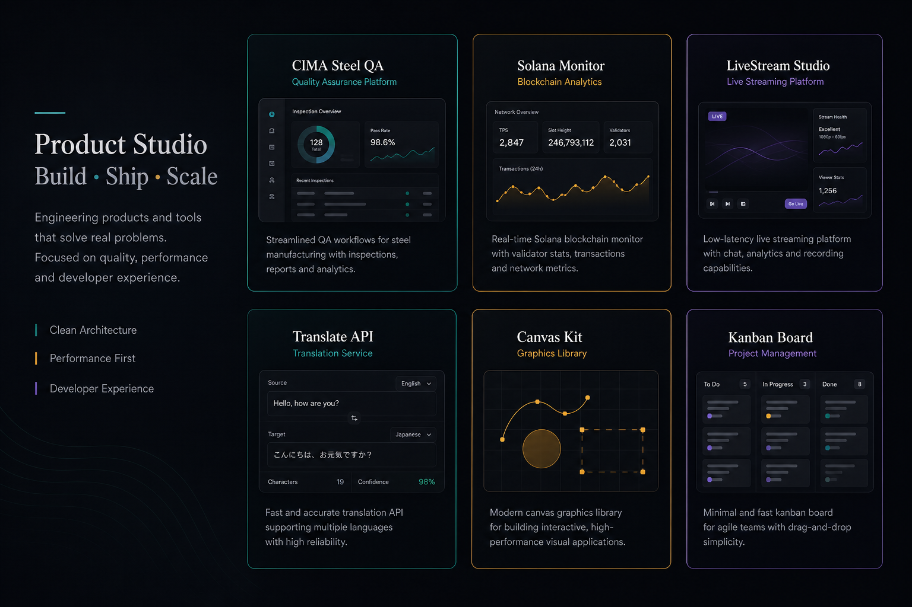

 

# Kevin Moe Myint Myat

### I'm back.

Application architect in Singapore.  
Platforms, developer tools, and products that stay up.

[LinkedIn](https://www.linkedin.com/in/kevinmoemyintmyat/) · [npm](https://www.npmjs.com/~m3yevn) · [Techlestial](https://techlestial.vercel.app)

---

The profile went quiet. The work did not.

This page is the front door again — flagship products, open-source tools, and the studios behind them.

---

## The work

### Products

| | What it is | Open |
|---|---|---|
| **[Kanbaneon](https://kanbaneon.vercel.app)** | Canvas Kanban for real boards | [code](https://github.com/m3yevn/kanbaneon) |
| **[CIMA](https://cima-flame.vercel.app/app/)** | Steel delivery QA, field to lab | [code](https://github.com/m3yevn/cima) |
| **[Solana Sentry](https://solana-sentry.vercel.app)** | Transaction monitoring and webhook checks | [code](https://github.com/m3yevn/solana-sentry) |
| **[PortokaLive](https://portokalive-web.vercel.app)** | Open-source live streaming | [org](https://github.com/PortokaLive) |
| **[Be A Buddhist](https://beabuddhist.vercel.app)** | Sacred audio, as a PWA | [code](https://github.com/m3yevn/beabuddhist) |
| **[Megasoft Market](https://megasoft-market.vercel.app)** | B2B commerce demo | [code](https://github.com/m3yevn/megasoft-market) |
| **[FTP Seer](https://ftp-seer-client.vercel.app)** | A web FTP browser and its API | [client](https://github.com/m3yevn/ftp-seer-client) |

### Tools

| | What it is | Open |
|---|---|---|
| **[Express Instant](https://express-instant.vercel.app)** | JSON-configured Express | [`express-instant`](https://www.npmjs.com/package/express-instant) |
| **[Gitlestial](https://gitlestial.vercel.app)** | Git CLI for changelogs and conventional commits | [`@techlestial/gitlestial`](https://www.npmjs.com/package/@techlestial/gitlestial) |
| **[Loglestial](https://loglestial.vercel.app)** | Colored logging for Node | [`@techlestial/loglestial`](https://www.npmjs.com/package/@techlestial/loglestial) |
| **[Uilerial](https://uilerial.vercel.app)** | React components, with a studio | [`@techlestial/uilerial`](https://www.npmjs.com/package/@techlestial/uilerial) |
| **[Vizat](https://vizat.vercel.app)** | Canvas 2D scene tree | [`vizat`](https://www.npmjs.com/package/vizat) |
| **[AppRAG](https://apprag.vercel.app)** | README and docs generator | [`apprag`](https://www.npmjs.com/package/apprag) |
| **[Translatial](https://translatial.vercel.app)** | Translation API | [code](https://github.com/techlestial/translatial) |

---

## Studios

| Studio | What lives there |
|---|---|
| **[m3yevn](https://github.com/m3yevn)** | Flagship products. This profile. |
| **[techlestial](https://github.com/techlestial)** | Developer tools on npm. [Studio](https://techlestial.vercel.app) |
| **[PortokaLive](https://github.com/PortokaLive)** | Streaming — web, API, and mobile |

A longer map of the same universe sits in [`docs/engineering-universe.md`](docs/engineering-universe.md).

---

**Kevin Moe Myint Myat** · Singapore

[LinkedIn](https://www.linkedin.com/in/kevinmoemyintmyat/) · [npm](https://www.npmjs.com/~m3yevn) · [GitHub](https://github.com/m3yevn)

